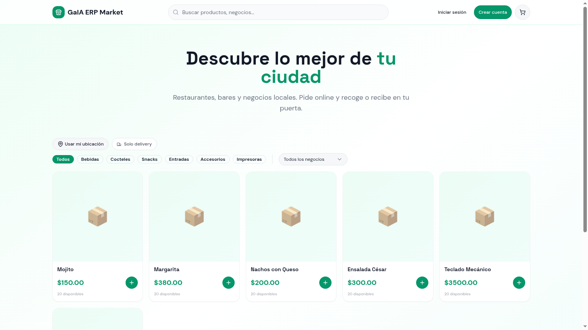
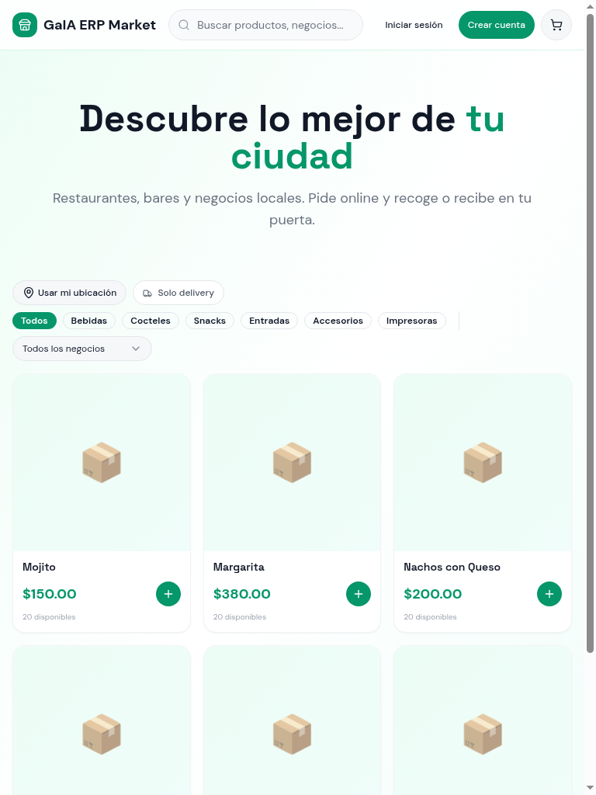
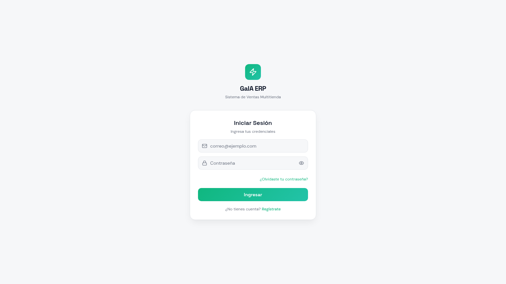

# 🌿 MarIA OS

### **El sistema operativo de tu negocio.**

Plataforma multi-tenant todo-en-uno para **restaurantes, bares, cafeterías y empresas de retail**.
Vende, gestiona, cobra, factura y entrega — desde una sola aplicación, en cualquier dispositivo.

---

## 🎯 ¿Para quién es MarIA OS?

| 🍔 Restaurantes | 🍹 Bares | 🛒 Retail / Empresas |
|---|---|---|
| Mapa de mesas, KDS de cocina, división de cuenta, recetas | Comandas rápidas, pestañas (tabs), múltiples cajeros | Catálogo SKU, multi-tienda, multi-almacén, transferencias |

> **Un solo sistema, tres modos de operación.** El POS y los menús se adaptan automáticamente al tipo de negocio que registres.

---

## 🌐 Vista pública — Marketplace integrado

Cada negocio recibe su **escaparate online gratuito** con catálogo, geolocalización y pedidos sin pago online (cobro a la entrega/recogida).

<table>
<tr>
<td width="50%">

### 📱 Mobile-first

</td>
<td width="50%">

### 🔐 Acceso seguro

Autenticación con email, recuperación de contraseña, roles separados y panel **Superadmin** para gestión de empresas.

</td>
</tr>
</table>

---

## 📦 Funcionalidades por módulo

### 🛒 Punto de Venta (POS) — *adaptable*
- **Modo Bar**: pestañas por cliente/silla, cobros rápidos, propinas.
- **Modo Restaurante**: comandas por mesa, envío automático a cocina, división de cuenta por ítem o partes iguales.
- **Modo Empresa/Retail**: búsqueda por SKU/código de barras, carrito ágil.
- **Multi-pago**: efectivo, tarjeta, transferencia, QR, mixto, crédito y pago parcial.
- **Multi-moneda**: CUP, USD, EUR con tasa de cambio configurable.
- Asociación automática al **turno** y **caja** activos.

### 🍽️ Operaciones de Restaurante
- **Mapa visual de mesas** con estados en tiempo real: libre · ocupada · reservada · cuenta pedida.
- **KDS (Kitchen Display System)**: pantalla de cocina con tickets, tiempos y estados (pendiente → preparando → listo).
- **Sincronización realtime** entre meseros, caja y cocina.
- **División de cuenta** flexible.

### 📦 Inventario inteligente
- CRUD de productos con SKU, código de barras, categoría, precio, costo, foto.
- Stock por almacén con **historial de movimientos** (entradas, salidas, ajustes, transferencias).
- **Alertas de stock mínimo** automáticas.
- **Recetas (BOM)** para restaurantes: descuenta ingredientes al vender el plato.
- **Disponibilidad online** y **delivery** por producto, con stock independiente.

### 🏪 Tiendas y 🏬 Almacenes
- Multi-tienda y multi-almacén con datos operativos.
- **Geolocalización** exacta en mapa para que el marketplace sugiera tiendas cercanas.
- Configuración de **delivery / recogida en local** y **radio de entrega**.
- **Transferencias** entre almacenes con trazabilidad.
- **Activity log** de cada movimiento.

### 🛍️ Compras y Proveedores
- Gestión completa de **proveedores** con historial, deuda actual y rastreo de productos suministrados.
- Órdenes de **compra** que actualizan stock automáticamente.
- **Devoluciones** a proveedor y de cliente.
- **Cuentas por pagar (CxP)** y **Cuentas por cobrar (CxC)** unificadas.
- **Consignaciones** (productos en depósito).

### 💳 Facturación + e-invoicing
- Facturación local con **PDF profesional** y envío por email.
- **Venta rápida** desde el módulo de Facturas (sin abrir el POS).
- Generación de **XML UBL 2.1** firmado (CUFE) listo para PAC/SUNAT/DIAN/SAT.
- **Webhook configurable** para conectar a cualquier proveedor de facturación electrónica.
- Estado de transmisión visible en tiempo real.

### 👥 Clientes y CRM
- Ficha completa con datos fiscales, balance y consumo histórico.
- **Alta automática** de clientes desde pedidos del marketplace (matching por teléfono/email).
- Programa de **fidelización** con puntos.

### 👨‍💼 Empleados y RRHH
- Gestión de empleados con asignación a tienda/rol.
- **Asistencia, horarios y nóminas**.
- Timeline de actividad por empleado.

### ⏰ Turnos y Cajas
- Apertura/cierre de turno con conteo de caja.
- Reporte X/Z, arqueo y diferencias.
- Asignación tienda + cajero + responsable.

### 🌐 Marketplace público + Pedidos online
- Catálogo público sin login, con búsqueda, categorías y filtros por negocio.
- **Geolocalización del dispositivo** para sugerir productos cercanos por radio (2/5/10 km).
- Filtro **"Solo delivery"** y badge de distancia por producto.
- Checkout requiere registro → cliente queda automáticamente vinculado a la tienda.
- Dashboard de **pedidos online** en tiempo real: pendiente → preparando → listo → entregado.

### 🛵 Delivery
- Zonas de reparto, asignación de repartidores.
- Seguimiento en tiempo real de pedidos asignados.

### 📒 Contabilidad
- Diario contable de doble entrada con validación de balance.
- Ingresos y gastos derivados automáticamente de las ventas y compras.
- Listado de transacciones por periodo.

### 📊 Analytics, Reportes & BI
- Dashboard con KPIs: ventas del día, ticket medio, productos top, comparativas.
- Reportes filtrables por tienda, turno, categoría, empleado.
- Exportación a CSV/Excel.

### 🔐 Roles, Permisos y Seguridad
- Tabla `user_roles` separada (anti-escalada de privilegios).
- **Matriz RBAC configurable por módulo**.
- Roles: admin, manager, cashier, kitchen, waiter, delivery…
- **Superadmin** con panel global para gestionar todas las empresas.

### ⚙️ Configuración global
- Datos del tenant (logo, moneda base, dirección).
- **Categorías**, **impuestos**, **monedas**, **métodos de pago**.
- Ajustes específicos del **POS** y módulos activos.
- Configuración de **facturación electrónica** (régimen, NIT, claves, webhook).

---

## 🏗️ Arquitectura multi-tenant

- 🔒 **Aislamiento total por tenant** mediante Row-Level Security en *todas* las tablas.
- 🎚️ **Sidebar dinámico**: el menú se adapta al tipo de negocio (`restaurante`, `bar`, `empresa`).
- 🔄 **Selector de empresa** en la barra lateral para superadmins.
- ⚡ **Realtime** vía Supabase para mesas, cocina y pedidos online.

---

## 📲 PWA Instalable

MarIA OS es una **Progressive Web App**: se instala en escritorio, Android e iOS, funciona offline en lectura y carga al instante con caché inteligente.

---

## 🛠️ Stack

**Frontend** · React 18 · Vite · TypeScript · Tailwind · shadcn/ui · TanStack Query · React Router
**Backend** · Lovable Cloud (Postgres + Auth + Storage + Edge Functions + Realtime)
**Infra** · RLS en cada tabla · Edge Functions para email, facturación electrónica y administración

---

### 🌱 Construido para crecer contigo.

*De un único punto de venta a una cadena multi-tienda con marketplace, sin cambiar de sistema.*

