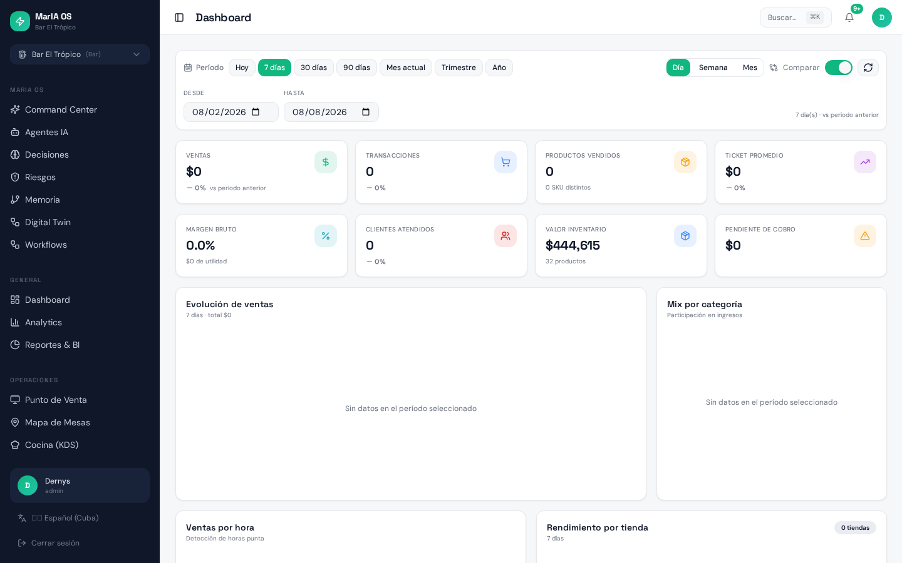
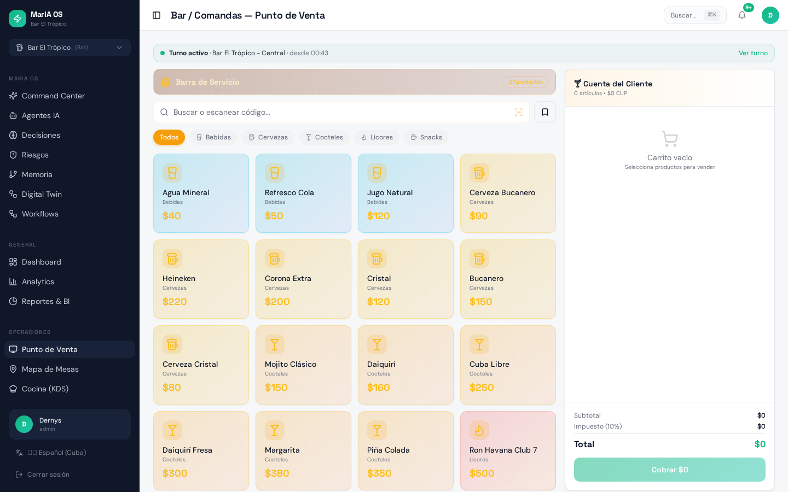
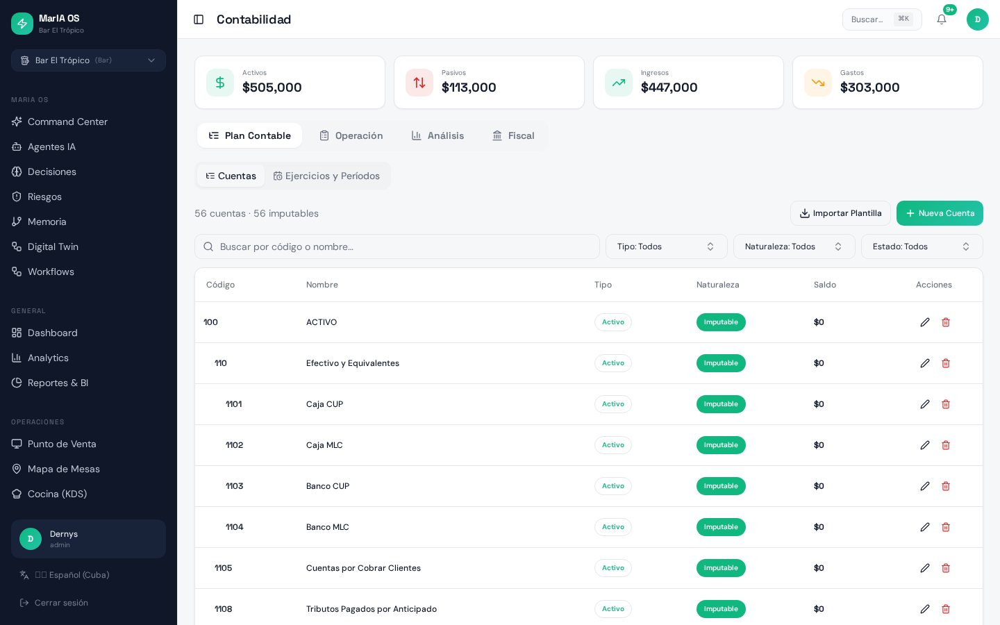
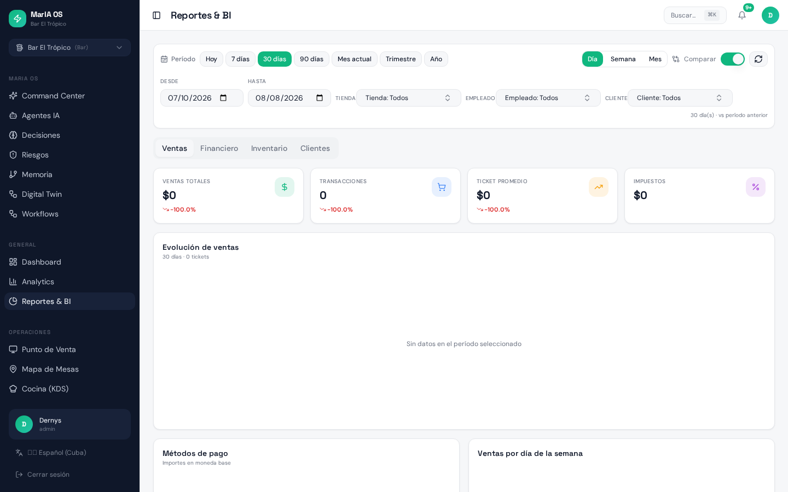
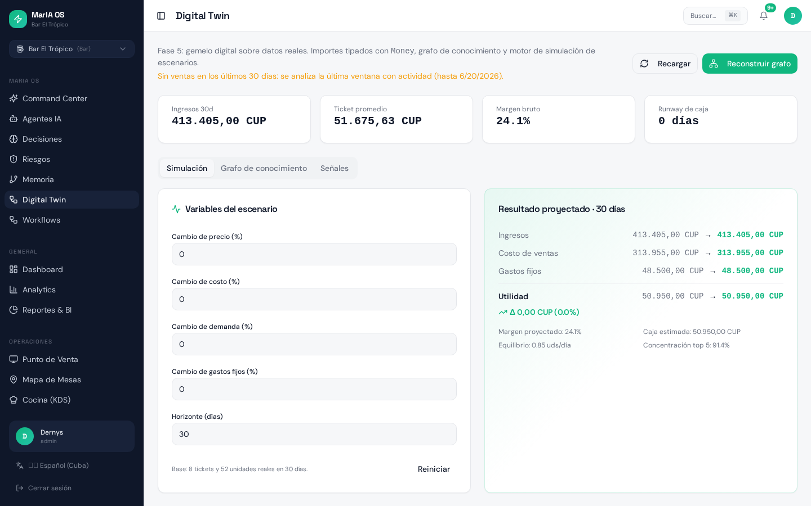
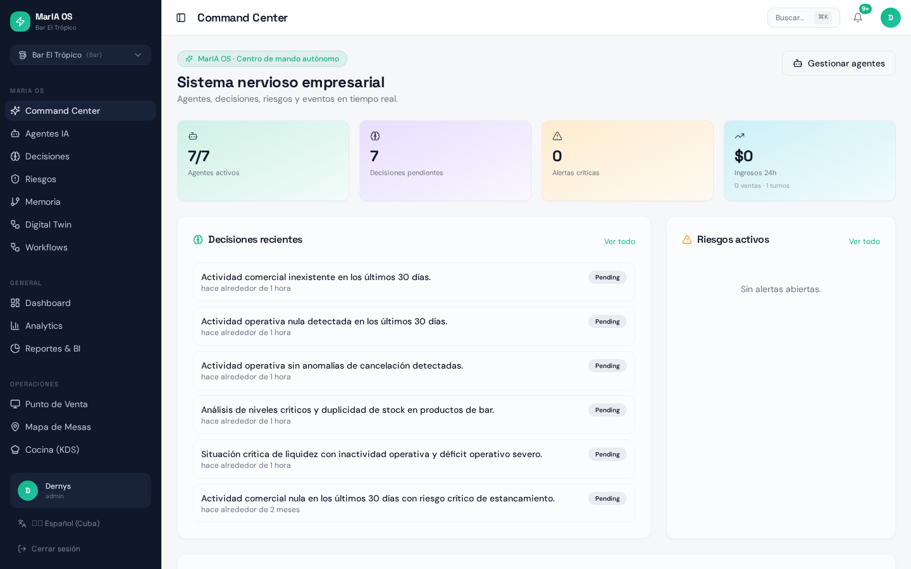

# MarIA OS — Investor & Customer Pitch Deck

**Exactly 10 slides.** Every claim is traceable to `docs/MARIA_OS_INVESTOR_DECK_EVIDENCE.md`.
Company: **Kirabit** · Product: **MarIA OS** · Date: **2026-08-08** · Stage: **Pre-Revenue / Pre-Seed**

**Status legend (used across all slides)**
🟢 LIVE — working end-to-end on real data · 🟡 PARTIAL — works but incomplete/unhardened · 🔵 IN DEVELOPMENT — code exists, not operationally proven · ⚪ ROADMAP — not built

---

## SLIDE 1 — Cover



# MarIA OS
### AI-Native Business Operating System for SMBs
**One platform to operate, understand and automate your business.**

| | |
|---|---|
| Developed by | **Kirabit** |
| Product stage | Advanced beta — 56 application screens, 130-table backend, 3 demo tenants with real transactional data |
| Commercial stage | **Pre-Revenue / Pre-Seed** — no paying customers, no MRR/ARR to date |
| Date | August 2026 |
| Cover image | Real screenshot: MarIA OS dashboard, tenant "Bar El Trópico" |

> Logo asset in repo: `src/assets/maria-logo.png`.

**Speaker notes.**
Open with one line: "MarIA OS is a working business operating system, not a deck." Say explicitly and early that we are pre-revenue — credibility is the asset we are trading on today. Emphasize: everything you will see in the next 9 slides is a screenshot of software running against a live multi-tenant database, with 3 seeded businesses (bar, restaurant, retail/B2B). Objection answered: "is this vaporware?" — answer: no, and we will show the schema counts and the accounting balance proof.

---

## SLIDE 2 — The Problem

**What SMBs in Cuba and Latin America actually run today:** a POS that doesn't talk to inventory, inventory that doesn't talk to accounting, accounting reconstructed manually at month-end, and zero forward-looking intelligence.

| Traditional fragmented stack | MarIA OS |
|---|---|
| POS app + spreadsheet inventory + external accountant | Single tenant database: sale → stock movement → journal entry in one transaction 🟢 |
| Financial truth known weeks later | Journal, ledger and period reports generated from operations 🟢 |
| Multi-currency handled by hand (CUP / MLC / USD) | Currency + exchange-rate tables and typed money objects 🟢 |
| Permissions = "everyone is admin" | Role matrix per module, 175 permission rows, 372 RLS policies 🟢 |
| No analytical or predictive layer | AI agents, forecasting RPCs, knowledge graph, scenario twin 🟡 |
| Each vertical needs different software | One platform adapting to tenant type: bar / restaurant / enterprise 🟢 |

Problems we address **because the code addresses them** (not as generic market claims):
1. Operational data fragmentation → unified multi-tenant schema (130 tables).
2. Disconnected accounting → automatic double-entry posting from sales, purchases, payroll, cash and inventory.
3. Manual cash control → shift management with one-open-shift-per-store enforcement and cash movements linked to journal entries.
4. Vertical-specific tooling → same platform, different module set per business type.
5. No decision support → AI agents producing auditable decisions and actions.

**Speaker notes.**
Do not claim market-wide statistics we cannot cite. Frame the problem from the product: "each of these six rows exists because we built the fix and can show it." Objection answered: "why would an SMB switch?" — because the switch replaces 3–5 tools and the month-end reconstruction of accounting. Data to emphasize: sale → journal entry is automatic and verified balanced across all three demo tenants.

---

## SLIDE 3 — The Solution: One Integrated Platform

```text
┌──────────────────────────────────────────────────────────────────────┐
│ INTELLIGENCE   AI Agents 🟡  Analytics/BI 🟢  Knowledge Graph 🟡      │
│                Digital Twin 🟡  Automation/Workflows 🔵              │
├──────────────────────────────────────────────────────────────────────┤
│ FINANCE        Accounting 🟢  Chart of accounts 🟢  Journal 🟢         │
│                General ledger 🟢  Periods & closing 🟢  Cash 🟡        │
│                A/R 🟢  A/P 🟢  Treasury 🟡  Banks/reconciliation 🔵    │
│                Invoicing 🟡  Tax/fiscal engine 🟡                     │
├──────────────────────────────────────────────────────────────────────┤
│ OPERATIONS     POS (bar/restaurant/enterprise) 🟢  Sales 🟢           │
│                Purchases 🟢  Inventory & kardex 🟢  Warehouses 🟢      │
│                Transfers 🟢  Counts 🟢  Recipes/production 🟢          │
│                Shifts & cash 🟢  Kitchen KDS 🟢  Tables 🟢             │
│                Delivery 🟡  Marketplace & online orders 🟡  HR 🟡      │
├──────────────────────────────────────────────────────────────────────┤
│ CORE           Tenants 🟢  Stores 🟢  Users 🟢  Roles & RBAC 🟢         │
│                Customers 🟢  Suppliers 🟢  Products & variants 🟢      │
│                Multi-currency 🟢  i18n (es/en/pt-BR) 🟢  Audit log 🟢  │
│                Event store (shadow) 🟡  Public API + webhooks 🔵       │
│                MCP agent integrations 🟡  PWA/offline 🟡               │
└──────────────────────────────────────────────────────────────────────┘
```

56 application screens · 130 tables · 177 server-side functions · 17 edge functions · 372 RLS policies.

**Speaker notes.**
Walk the stack bottom-up: "data → operations → finance → intelligence." The point to land: the intelligence layer is only credible because the three layers below it are real and populated. Objection answered: "is this an ERP wrapper on GPT?" — no: the AI reads the same governed tenant data the operational modules write. Be honest about the 🟡/🔵 markers when asked; that honesty is the pitch.

---

## SLIDE 4 — The Real Product (Real Screenshots)

| Screenshot | Module | What it proves |
|---|---|---|
|  | **POS — Bar/Comandas** 🟢 | Active shift banner, category-filtered catalog with real seeded products and CUP pricing, live cart with tax line. |
|  | **Executive dashboard** 🟢 | Period presets, comparison toggle, KPI tiles (sales, margin, inventory value $444,615, pending collections), sales evolution and category mix. |
|  | **Accounting** 🟢 | 56-account chart with type/nature/status filters, asset/liability/income/expense headline figures, fiscal years and periods. |
|  | **Reports & BI** 🟢 | Server-side financial statements (P&L, balance sheet, trial balance, journal, ledger) with period selection and export. |
|  | **Digital Twin** 🟡 | Scenario engine over real data: 413,405 CUP 30-day revenue base, price/cost/demand/fixed-cost levers, projected margin and break-even. |
|  | **AI Command Center** 🟡 | Agent roster, pending business decisions and operational signals for the active tenant. |

Additional captured evidence: `inventario.png`, `compras.png`, `turnos.png`, `analytics.png`, `agents.png`, `risk.png`, `rrhh.png`, `tesoreria.png`, `marketplace.png`, `landing.png` — full index in `docs/MARIA_OS_SCREENSHOT_INVENTORY.md`.

**Speaker notes.**
This is the trust slide — spend the most time here. State that no image is a mockup, stock photo or AI-generated interface; all were captured programmatically from the running application on 2026-08-08 as an authenticated admin of the demo tenant. If someone asks for a live demo, offer the three demo tenants and role-based demo logins. Flag proactively: the dashboard's 7-day window shows zeros because seeded transactions are older than the default range — pick a wider range when demoing live.

---

## SLIDE 5 — Technical Differentiation

Architecture as layers: **Data → Business Operations → Finance → Intelligence → AI → Automation**

| Capability | Status | Evidence found |
|---|---|---|
| Multi-tenant architecture | 🟢 Implemented | 130/130 public tables with RLS enabled, 372 policies, `is_tenant_member` / `is_tenant_owner` / `has_role` security-definer helpers, 6 tenants live |
| Financial engine (double entry) | 🟡 Implemented, requires hardening | Debits = credits exactly in all 3 populated tenants (135,500 / 197,258 / 1,917,537); 0 completed sales without a journal entry; general ledger populated; banking and cash-movement coverage still thin |
| Configurable RBAC | 🟢 Implemented | Roles in a separate `user_roles` table, `role_permissions` matrix (175 rows) across 35 modules, `my_permissions` RPC, `PermissionGate` in UI |
| Analytics / BI | 🟢 Implemented | Dedicated analytics hooks, chart-token theme, KPI tiles with deltas, ABC analysis, server-side report RPCs |
| AI agents | 🟡 Partial | 7 agents per tenant, 5 AI edge functions (`agent-runner`, `risk-scanner`, `inventory-intelligence`, `logistics-optimizer`, `workflow-runner`), 25 recorded agent actions, 8 business decisions, autonomy levels with approval flow |
| Knowledge graph | 🟡 Partial | 206 nodes / 279 edges built from real tenant data |
| Digital twin / simulation | 🟡 Partial | Pure-domain simulation engine with 14 unit tests, scenario UI over live aggregates |
| Event-driven architecture | 🟡 Shadow mode | `domain_events` append-only store, 248 events, divergence panel; not yet the source of truth |
| Agent interoperability (MCP) | 🟡 Partial | MCP server with 5 OAuth-scoped tools deployed as an edge function |
| Fiscal / multi-country engine | 🟡 Partial | Generic `compute_tax_declaration`, Cuban (ONAT) and Brazilian (NF-e, SPED, eSocial) scaffolding, `fiscal_rules` table present but unconfigured in every tenant |
| Real-time data | 🟢 Implemented | Realtime channels for tables, kitchen orders, delivery and dashboard invalidation |
| Automation / workflows | 🔵 In development | Workflow tables and runner function exist; 0 workflows configured |
| Public API + webhooks | 🔵 In development | `api-v1` edge function, tenant API keys, webhook dispatcher; 0 webhooks registered |
| Payments / billing infrastructure | ⚪ Roadmap | No subscription billing implemented |

**Speaker notes.**
Lead with multi-tenancy and the accounting balance proof — those two are the moat and the credibility anchor. Then say plainly: "AI agents, twin, graph and event store are real code with real data but not yet production-hardened; that is exactly what the round funds." Objection answered: "what stops a competitor?" — the integrated financial engine plus tenant-governed data model is 18+ months of domain work, not a UI.

---

## SLIDE 6 — Product Maturity Scorecard

Scale: 0 none · 1 conceptual · 2 prototype · 3 implemented · 4 production ready · 5 enterprise ready.

| Area | Score | Basis |
|---|---|---|
| Core platform | 4 | 56 screens, 130 tables, i18n (3 locales), audit log (5,261 entries), PWA |
| Multi-tenancy | 4 | 0 tables without RLS, 372 policies, tenant context switcher |
| POS | 4 | Three vertical variants, shifts, parked sales, split bills, receipt printing |
| Inventory | 4 | Kardex, lots, serials, variants, warehouses↔stores, transfers, counts, recipes |
| Procurement | 3 | Purchases with receiving, A/P generation, supplier costs |
| Accounting | 3 | Balanced double entry, ledger, periods, closing, statements |
| Finance (cash/banks/treasury) | 2 | Cash movements posted to accounting, but 0 bank accounts and ~1 cash movement across all tenants |
| HR | 2 | Employees, contracts, attendance, payroll RPCs; low real usage in demos |
| AI | 2 | Agents + decisions + actions operational; no evaluation harness, no cost controls |
| Digital twin | 2 | Tested domain engine, single-scenario UI |
| Security | 3 | RLS everywhere, fixed `search_path`, all 17 views `security_invoker`; 5 edge functions with `verify_jwt = false` |
| RBAC | 3 | Full matrix + server resolution; UI enforcement present but only 5 files consume the gate |
| Reporting | 3 | Server-side statements + BI layer; account balance column renders 0 in the chart-of-accounts view |
| Observability | 3 | Correlation IDs client→edge→DB, activity log, audit panel |
| Automated testing | 1 | 66 unit tests in 7 files, all pure domain; 0 integration, 0 E2E |
| SaaS readiness | 1 | No billing, no plan gating, no usage metering, no onboarding self-service |

### Current Product Maturity: **2.7 / 5**
(Unweighted mean of the 16 areas above = 43/16 = 2.69.)

**Strengths**
1. Genuine multi-tenant isolation with zero RLS gaps.
2. Operations→accounting integration that provably balances on real data.
3. Breadth: POS, inventory, procurement, finance, HR and BI in one product.
4. Vertical adaptivity (bar / restaurant / enterprise) from one codebase.
5. Intelligence layer already wired to real tenant data, not to demos.

**Gaps**
1. **Financial engine — requires hardening**: banks/reconciliation and cash flow barely exercised; fiscal rules unconfigured.
2. Test pyramid is one layer deep — no integration or E2E coverage.
3. No SaaS commercial machinery (billing, metering, plan limits).
4. Data access still UI-coupled: 38 of 56 pages query the database directly; only 3 use server-side pagination.
5. AI layer lacks guardrails: no cost ceilings, no output evaluation, low decision volume.

**Speaker notes.**
Present the 2.7 as a feature of the pitch, not a weakness: an investor who hears a self-reported 4.5 stops believing everything else. Emphasize that no gap is architectural — all five are execution items with known effort. Objection answered: "what is left to reach production?" — hardening, tests, billing; roughly the scope of the proposed round's product line item.

---

## SLIDE 7 — Value for the Customer

**Current capabilities (verified in product)**
- One system of record for sales, stock, purchases, cash, payroll and accounting.
- Automatic journal entries from operations — no manual month-end reconstruction.
- Shift-level cash control with one open shift per store and worker-authenticated handover.
- Real-time inventory valuation and low-stock signals (dashboard shows $444,615 inventory value for the demo bar).
- Multi-currency operation (CUP / MLC / USD) with exchange-rate history.
- Role-scoped access so cashiers, managers, accountants and owners see different systems.

**Potential business impact — requires customer validation**
| Lever | Mechanism in product | Claim status |
|---|---|---|
| Less administrative work | Accounting generated from operations | Potential impact — requires customer validation |
| Fewer data errors | Single write path, typed money, invariant checks | Potential impact — requires customer validation |
| Inventory shrink control | Kardex + counts + transfers with audit trail | Potential impact — requires customer validation |
| Faster decisions | Real-time BI + agents + twin | Potential impact — requires customer validation |
| Tool consolidation | POS + inventory + accounting + BI in one subscription | Potential impact — requires customer validation |

**Illustrative scenario — not historical customer data**
A hypothetical retail SMB: 12 employees, 2 stores, ~2,500 monthly transactions.
- Fragmented stack (illustrative): POS subscription + inventory tool + accounting software + external bookkeeping hours + spreadsheet reconciliation time.
- MarIA OS (illustrative): one subscription replacing those tools, with bookkeeping reduced to review rather than reconstruction.
- Modeled effect: consolidation of 3–5 vendor line items and reduction of manual reconciliation hours.
- **Every figure in this scenario is hypothetical. MarIA OS has no historical customer savings data — validation with 5–10 pilot customers is the first milestone of the proposed round.**

**Speaker notes.**
Say the words "illustrative scenario, not customer data" out loud before showing the numbers — investors reward that discipline. Emphasize that we deliberately did not fabricate ROI percentages. Objection answered: "who pays and why?" — an owner already paying for 3–5 tools plus bookkeeping hours; the pilot program measures the actual delta.

---

## SLIDE 8 — SaaS Model & Monetization

**Revenue architecture (proposed — nothing is priced or billed today)**

| Stream | Content | Product support today |
|---|---|---|
| SaaS subscription — Starter / Professional / Business / Enterprise | Seats, stores, modules by tenant type | 🟡 Module registry (35 modules) and per-tenant module settings exist; **no billing or plan gating** ⚪ |
| Usage-based AI | Agent runs, AI requests, automation, knowledge processing | 🟡 AI functions and action logging exist; **no metering or cost ceilings** ⚪ |
| Transaction revenue | Marketplace / online orders | 🟡 Marketplace and online orders work as order capture; **no payment processing** ⚪ |
| Premium modules | Advanced finance, AI, analytics, digital twin, enterprise integrations | 🟡 All modules exist; packaging not implemented |
| Professional services | Implementation, migration, customization, training | 🟢 Deliverable today with existing product |

**Pricing: proposal only — not current market prices.** Indicative BRL tiers for a Brazil-first go-to-market would be defined during pilot pricing tests; MarIA OS has no published or contracted price. Any figure shown in conversation must be labeled *pricing hypothesis*.

**Target SaaS metrics — all TARGET / PROJECTION, none actual**
| Metric | Actual | Target |
|---|---|---|
| Paying customers | 0 (Pre-Revenue) | First 5–10 pilots post-funding |
| ARPU | Not available currently — requires commercial validation | Target, set during pricing tests |
| MRR / ARR | 0 | Target: first recurring contracts within the funded period |
| Gross margin | Not available currently | Target: typical SaaS range, net of AI inference cost |
| CAC / LTV / Churn / NRR | Not available currently — no customers | Measured from first cohort onward |

**Speaker notes.**
Be aggressive about labeling: repeat "zero revenue today" rather than letting a target table imply traction. The credible message is that the monetization surfaces already exist in the product (modules, AI actions, marketplace) and what is missing is the commercial layer — billing, metering, packaging — which is a scoped engineering task, not a product pivot. Objection answered: "can this monetize beyond licenses?" — yes: AI usage and marketplace transactions, once payments are added.

---

## SLIDE 9 — Market & Scalability

**Market sizing requires external validation.** No TAM/SAM/SOM study exists in this project, and we will not present invented figures.

| Layer | Definition | Status |
|---|---|---|
| TAM | Global SMB business-management software | Not available currently — requires external market study |
| SAM | Latin American SMBs in retail, food service and light industry needing integrated ops+finance | Not available currently — requires external market study |
| SOM | Reachable segment in the first geographies (Cuba, Brazil) | Not available currently — requires commercial validation |

**Why the architecture can internationalize (verified in product)**
- Multi-tenant by construction: one deployment, isolated tenants, 0 RLS gaps.
- Per-tenant fiscal configuration: `fiscal_rules`, tax rates, invoice series, chart-of-account templates.
- Country modules already scaffolded: Cuba (ONAT declarations, cost sheets) 🟡 and Brazil (NF-e, SPED, eSocial tables) 🔵.
- Multi-currency and exchange-rate history 🟢.
- i18n with Spanish, English and Brazilian Portuguese 🟢.
- Vertical adaptivity: bar, restaurant and enterprise tenants run the same core with different module sets 🟢.

**Expansion path (plan, not traction):** Cuba/Caribbean beachhead → Brazil → wider Latin America → global SMB SaaS.

**Demo environments available for evaluation**
| Demo tenant | Type | Status |
|---|---|---|
| Bar El Trópico | Bar | 🟢 Populated: 32 products, 24 sales, 33 journal entries, 75 stock movements, 8 customers, 7 employees, 2 shifts, role-based logins |
| Restaurante La Mesa | Restaurant | 🟢 Populated: 34 products, 20 sales, 30 journal entries, 57 stock movements, recipes and kitchen flow |
| TechStore Cuba | Enterprise / retail-B2B | 🟢 Populated: 30 products, 18 sales, 8 invoices, 27 journal entries, 13 payables |
| Bar / Restaurante / Retail "MarIA Demo" | 3 additional tenants | 🟡 Structure only: users, roles and chart of accounts seeded; **no transactional data** — not to be presented as functional demos |

**Speaker notes.**
When asked for market size, answer: "we refuse to quote a number we cannot source; commissioning that study is a line item in the round." That answer usually scores better than a fabricated $XXB slide. Then pivot hard to the architectural internationalization evidence, which is verifiable. Objection answered: "why Brazil?" — the fiscal scaffolding and pt-BR localization already exist; entry cost is lower than for any other market.

---

## SLIDE 10 — Investment Opportunity

# MarIA OS
### Building the AI-native operating layer for SMBs.

| Dimension | Position |
|---|---|
| **Current stage** | Pre-Revenue / Pre-Seed — 0 customers, 0 MRR |
| **Product** | Maturity **2.7 / 5**; 56 screens, 130 tables, 177 server functions, 3 populated demo tenants |
| **Technology** | Multi-tenant with 0 RLS gaps · balanced double-entry engine · AI agents · knowledge graph · digital twin · event store (shadow) · MCP agent interoperability |
| **Market** | TAM/SAM/SOM not yet validated — external study required |
| **Business model** | SaaS subscription + usage-based AI + premium modules + professional services (all proposed; billing not yet built) |
| **Team** | Kirabit — founding technical team |

**Proposed Pre-Seed Round** — *no round is currently open or committed.*
Proposed fundraising range: **R$500k – R$1.5M** (indicative reference only).

**Potential use of funds**
1. Product hardening — financial engine, banking/reconciliation, integration and E2E test suite.
2. Brazilian market entry — fiscal compliance completion, pt-BR go-to-market.
3. AI development — agent guardrails, evaluation, cost control.
4. Sales and customer acquisition — first 5–10 pilot customers.
5. Security and compliance — external audit, data protection.
6. Team — engineering plus first commercial hire.

**Milestones**
```text
Funding ──▶ Product Validation ──▶ First Customers ──▶ Product-Market Fit ──▶ Seed
(hardening,   (5–10 pilots,          (paid contracts,     (retention + NRR      (metrics-backed
 tests,        measured ROI)          first MRR)           evidence)             round)
 billing)
```

> **MarIA OS is not another business application.
> It is an intelligent operating layer for the modern business.**

**Speaker notes.**
Close by restating the trade: we are not selling traction, we are selling a built platform plus a measurable path to traction. Name the ask as a proposal, never as an open round. The last data point to leave in the room: three demo businesses, running real operations, whose books balance to the cent — verifiable in five minutes. Objection answered: "what does the investor get?" — entry at pre-seed valuation into a product whose replacement cost already far exceeds the round.
